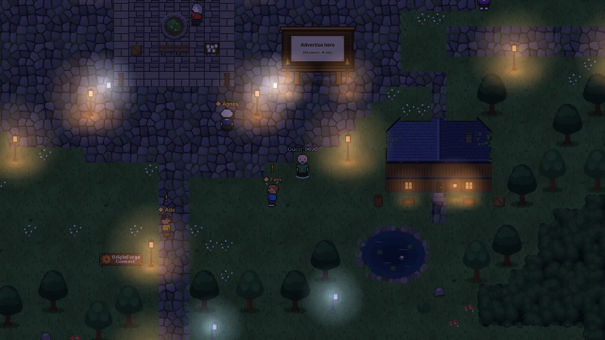
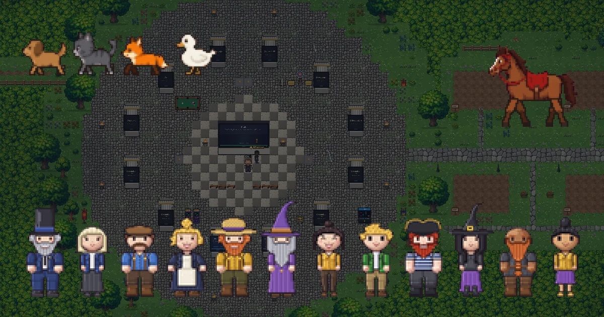
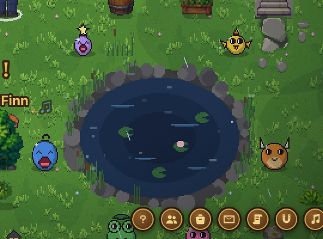
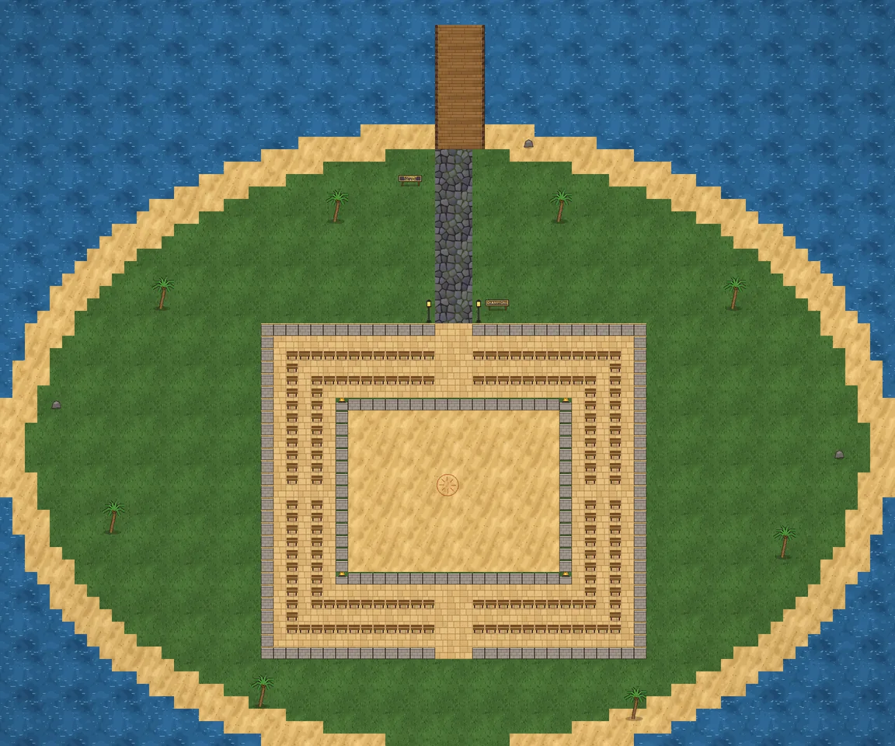
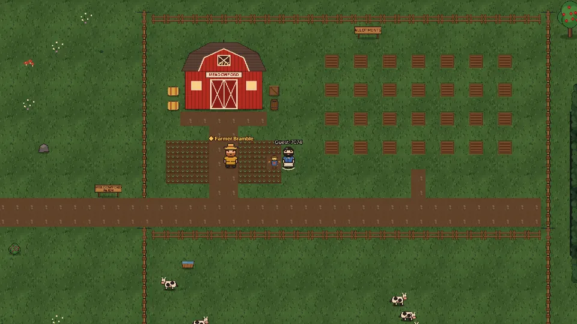
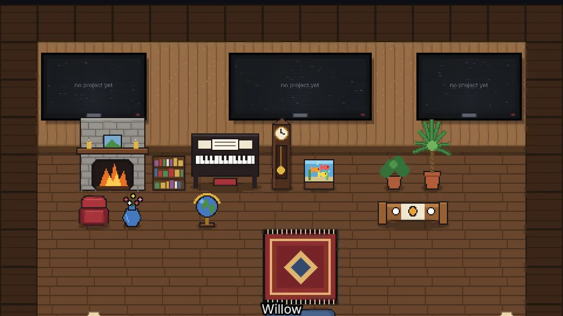
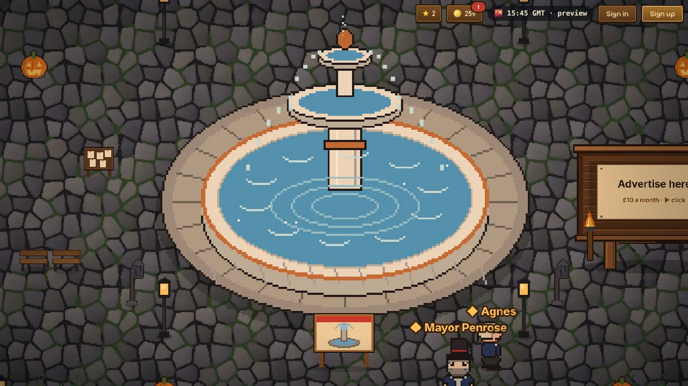

  

<h1 align="center">OriginForge Connect</h1>

<b>A free pixel-art town for founders, builders and makers.</b> 
Gather, craft, farm, duel, build a home, and meet other people building things.

  <a href="https://originforgeconnect.com/play/"><b>▶ Play free in your browser</b></a> ·
  <a href="https://originforgeconnect.com/advertise/">Advertise from £1 a month</a> ·
  <a href="https://originforgeconnect.com/blog/">Devlog</a> ·
  <a href="https://originforgeconnect.com/guide/">Player guide</a>

---

## What is it?

OriginForge Connect is a multiplayer town you play in your browser: no download, free to play. It has the
gather-craft-level feel of the classic RPGs, built around a community of people who make things. Walk round the
Founders Village, chat, pick up a skill, and show off what you're building.

## Things to do

- **Skills to level:** mining, smithing, woodcutting, fishing, cooking, farming, construction, magic and more, each to level 100 with a skill cape.
- **Your own home:** buy a plot, design your house, furnish it, and add a garden.
- **Farming at Meadowford:** grow crops on real-time timers in the allotments or your own garden.
- **Combat Island:** duel other players with magic in the Colosseum, or team up for 2v2 battles.
- **Build together:** the whole village chips in to build the fountain in the square, a piece per builder.
- **Every building opens:** huts, cabins, the Longhouse, the Sun Temple, the Lighthouse and two mine caves, with a hidden chest somewhere each day.
- **The Pond Singers:** six little monsters who each sing a note. Play them a tune, if you can find their song.
- **Make it yours:** character creator, hats, armour, pets, rides and dances.
- **Business School and Coding Academy:** learn by playing.

  
  
  
  
  
  

## Advertise your product

Don't have time to play? List up to 5 of your products for **£1 a month**. They show on the
[Advertise board](https://originforgeconnect.com/advertise/), with a chance to be featured on the home page and on
billboards in the game.

## Found a bug? Got an idea?

Please [open an issue](../../issues/new/choose): there's a form for bug reports and one for ideas. You can also say
hello in [Discussions](../../discussions).

## What's new

See the [changelog](CHANGELOG.md) and the [roadmap](ROADMAP.md), or read the full
[devlog](https://originforgeconnect.com/blog/).

## About

Made in Manchester, UK, by [OriginForge Studio](https://originforgestudio.co.uk) (Paul Yorke).
*Create. Build. Evolve.*

The game's source code is private. This repository holds the game's public information, screenshots, changelog and
issue tracker. All screenshots and artwork © OriginForge Studio Ltd.
